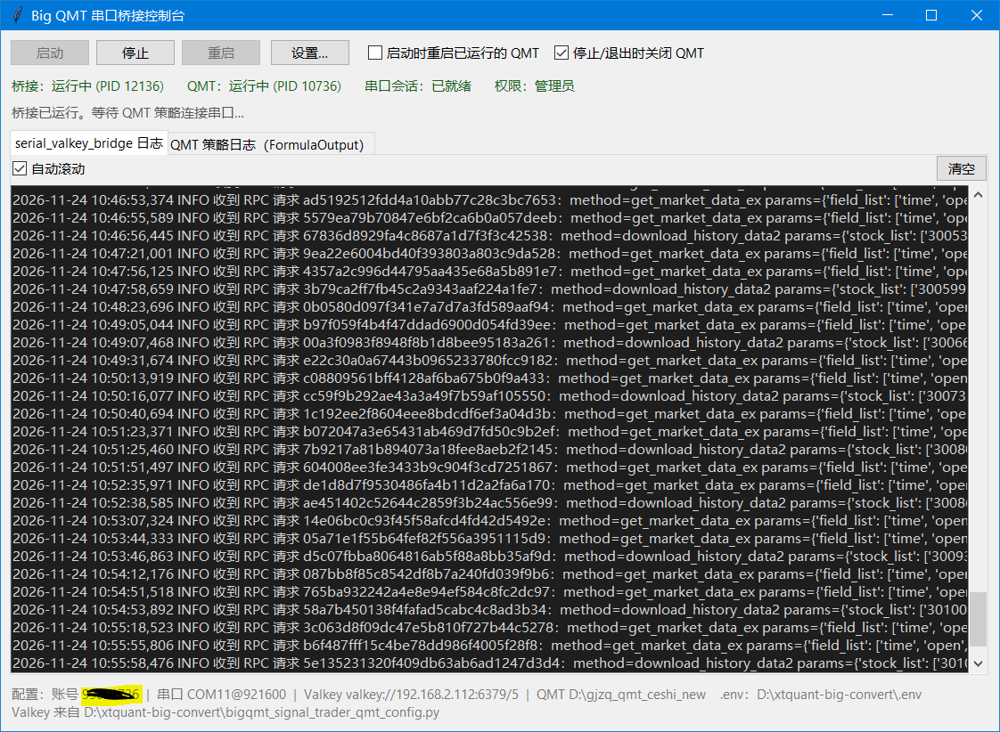

# xtquant_big_convert[valkey, serial]

大 QMT 运行环境里的 RPC 桥接包：把大 QMT 内置 Python（行情查询、交易、持仓）封装成可远程调用的服务，并兼容一组 MiniQMT（xtquant）方法名，使外部程序无需 XtQuantServer 权限即可驱动大 QMT。

本项目是个人学习与技术研究的产物，不是面向公众的产品。

## 项目状态

**券商已禁止本项目原有的远程传输方案。** VK 迁移不改变这一限制。仓库中的相关代码与文档仅供历史研究。

## 免责声明

- 本项目仅供学习与技术研究使用。**请在法律法规允许的范围内使用本项目**；使用前请自行确认你的使用行为符合所在国家/地区的法律法规、证券交易所规则以及券商客户协议的要求。
- 本项目不构成任何投资建议，不提供投资咨询服务。基于本项目进行的任何交易操作，其风险与后果由使用者本人承担，与作者无关。
- 本项目按"现状"（AS IS）提供，不附带任何明示或默示的保证。因使用或无法使用本项目导致的任何直接或间接损失（包括但不限于资金损失、数据错误、交易故障、账户异常），作者不承担任何责任。
- **任何人对本项目进行修改、二次开发或再分发的行为及其后果，均与原作者无关**，由行为人自行承担全部责任。
- 接入真实交易账户前，请充分了解程序化交易的风险，自行做好权限控制与风控措施。远程下单能力默认关闭（`rpc_allow_order_methods=False`），显式开启即视为你已知晓并接受上述条款。

使用本项目即表示你已阅读、理解并接受以上全部条款。

## 安装

项目不提供 pypi 包，请在源码目录安装外部客户端和 VK 依赖：

```bash
pip install ".[valkey]"
```

本项目要求 **Python 3.12 或更高版本**，适用于客户端、QMT 策略和独立串口桥接。直连 VK 的 QMT 策略需在实际运行的解释器中安装 `valkey`。客户端和策略可连接同一个现有 VK 服务。部署步骤见[使用指南](docs/USER_GUIDE.md)。

外部客户端、CLI 和串口桥接会读取启动目录中的 `.env`。可参照 [`.env.example`](.env.example) 设置 `BIGQMT_ACCOUNT_ID` 和 VK 连接参数。显式传入的参数优先，其次是 `.env`，再按各入口原有顺序读取其他配置。QMT 策略沿用部署配置和进程环境，`bigqmt-init` 可在 QMT 外读取 `.env` 的账号和 VK 分项值，作为生成部署配置的默认值。

新增 windows 客户端，用于控制 com 端口接入 VK 以及 QMT 终端的启停。



## 文档导读

- [使用指南](docs/USER_GUIDE.md)：功能、配置与排错
- [部署快速开始](docs/DEPLOY_QUICKSTART.md)；
- [RPC API 参考](docs/RPC_API_REFERENCE.md)；
- [传输层](docs/RPC_TRANSPORTS.md)
- [策略转换工具](docs/MiniQMT_2_BigQMT-Skill/README.md)；
- [延迟报告](docs/LATENCY_REPORT.md)
- 实现细节和行为契约见 `src/` 与 `tests/`。

## License

MIT，见 [LICENSE](LICENSE)。
