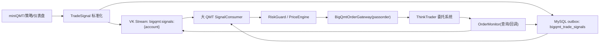
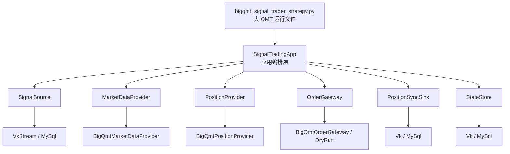
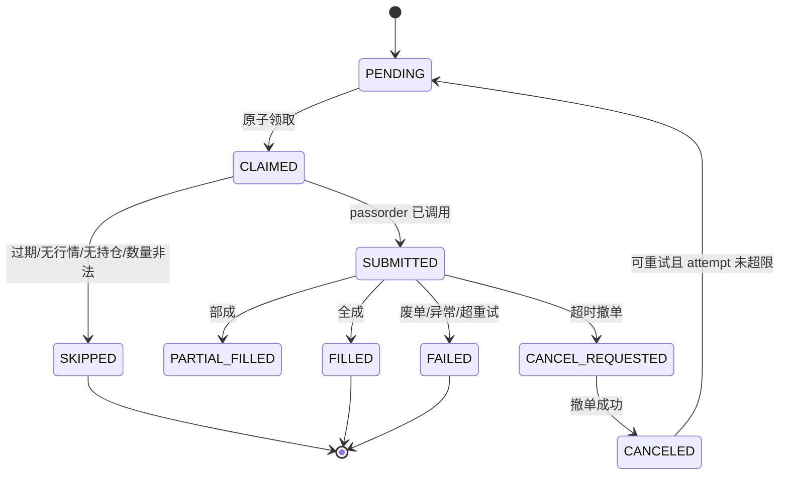

# 大 QMT 信号下单包实施方案

**目标**：在大 QMT 策略环境内建立一套可替换、组件化的买卖信号消费与下单包，通过 VK（主）与 MySQL（备/审计）同步外部标准化交易信号，使大 QMT 作为唯一真实委托执行端（本阶段不改/不删现有 miniQMT 下单逻辑）。

**技术栈**：Python、ThinkTrader 大 QMT 内置交易函数（`passorder` / `cancel` / `get_trade_detail_data`）、VK、MySQL、可选 SQLite 本地缓存。

---

## 1. 现状与改造边界

- **可复用（参考 `jq2qmt-main/src/api/qmt_jq_trade`）**：`init` / `adjust` 定时调度、`passorder` 下单、`get_trade_detail_data` 查委托与持仓、`cancel` 撤单、基于 `get_full_tick` + `get_instrumentdetail` 生成限价。
- **需改造**：原脚本同步「目标持仓」且无信号幂等/状态写回/重启恢复；新包只消费外部已决策好的**逐笔买卖信号**，不在大 QMT 内做策略判断。
- **miniQMT 指令迁移**：将现有 `buy_commands`（`stock_code`/`amount`/`force`）、`sell_commands`（`stock_code`/`percentage`）、`clear_positions`（`percentage`）及 `core.trader.execute_order()` 的白名单/锁定拦截、自动策略每日熔断、人工/清仓绕过熔断、卖出可用量截断等安全语义迁移为信号字段与消费端前置校验。

---

## 2. 目标架构与可替换边界



- **通道优先级**：① **VK Stream** 为主通道（支持 consumer group / ack / pending 重试，断线不丢消息）；② **MySQL outbox** 作备用与全量审计（VK 不可用时兜底轮询 `pending`）；③ 第一版**不用 VK Pub/Sub 直接下单**（断线丢消息且长阻塞订阅线程影响稳定性）。



| 能力 | Protocol 接口 | 默认 Adapter | 可替换 Adapter | 禁止写死位置 |
|------|--------------|-------------|---------------|-------------|
| 信号读取 | `SignalSource`（`fetch`, `ack`） | `VkStreamSignalSource` | `MySqlSignalSource` / HTTP / 文件回放 | `runner.py` |
| 状态写回 | `StateStore`（`claim`, `mark_submitted`, `mark_finished`） | `VkStateStore` + `MySqlStateStore` | SQLite / 本地文件 / Dashboard API | `OrderGateway`, `runner.py` |
| 行情 / 标的 | `MarketDataProvider`（`get_ticks`, `get_instrument`） | `BigQmtMarketDataProvider` | miniQMT / VK / 回测行情 | `price_engine.py`, `code_utils.py` |
| 持仓 / 资金 | `PositionProvider`（`get_positions`, `get_asset`） | `BigQmtPositionProvider` | miniQMT / MySQL 快照 / fake | `risk_guard.py` |
| 下单 / 撤单 | `OrderGateway`（`submit`, `cancel`, `query_orders`, `query_trades`） | `BigQmtOrderGateway` | `DryRunOrderGateway` / miniQMT gateway | `SignalTradingApp` |
| 持仓同步 | `PositionSyncSink`（`publish`） | `MySqlPositionSyncSink` / `VkPositionSyncSink` | VK Hash / Dashboard API / 日志 | `runner.py` |
| 调度 / 回调 | `RuntimeAdapter` | `BigQmtRuntimeAdapter` | CLI runner / test runner | 包内部服务 |

- **唯一编排入口 `SignalTradingApp`**：提供 `on_init(runtime)`、`tick(now)`、`on_order_event(event)`、`on_trade_event(event)`、`sync_positions(reason)`。大 QMT 入口（`init` / `adjust` / 委托与成交回调 / 手动 `sync_positions`）**只做对象转换与转发**，不直接调用 VK / MySQL / `passorder` / `get_trade_detail_data` / 价格或风控逻辑。

---

## 3. 标准信号协议

```json
{
  "signal_id": "20260630-wangju-000001.SZ-buy-000001",
  "account_id": "wangju", "source": "dashboard", "source_type": "manual",
  "action": "BUY", "stock_code": "000001.SZ", "stock_name": "平安银行",
  "amount": 1000, "percentage": null, "price_type": "AUTO_LIMIT", "price": null,
  "strategy_name": "bigqmt_signal_trader", "remark": "web_buy_command",
  "force": false, "bypass_stop_buy": false, "bypass_stop_sell": false, "bypass_daily_limit": false,
  "created_at": "2026-06-30 09:31:00", "expire_at": "2026-06-30 09:36:00", "schema_version": 1
}
```

- **必填与语义**：
  - `signal_id`（全局唯一幂等键，不可仅用股票代码）、`account_id`（账户隔离）、`source`（`dashboard`/`miniqmt_strategy`/`t0`/`risk`）、`source_type`（`manual`/`auto`）、`action`（`BUY`/`SELL`/`CLEAR`/`CANCEL`，一期实现前三种）、`price_type`（`AUTO_LIMIT`/`FIX_PRICE`）、`remark`（写 `userOrderId`/备注审计）、`created_at`、`expire_at`（过期必须跳过）、`schema_version`。
  - `BUY` 必填 `stock_code` + `amount`；`SELL` 必填 `stock_code` 及 `amount`/`percentage` 之一；`FIX_PRICE` 必填 `price`；`force` 与 `bypass_*` 保留人工卖出/清仓绕过逻辑。
- **miniQMT 指令映射**：
  - `buy_command`：`action="BUY"`、`price_type="AUTO_LIMIT"`、`bypass_stop_buy=force`、`bypass_daily_limit=False`、默认 300s 过期。
  - `sell_command`：`action="SELL"`、`percentage` 默认 100、`force=bypass_stop_sell=bypass_daily_limit=True`、300s 过期。
  - `clear_command`：`action="CLEAR"`、`stock_code="*"`、`force=bypass_stop_sell=bypass_daily_limit=True`、180s 过期。

---

## 4. 目录与模块职责

- **包目录 `src/bigqmt_signal_trader/`**：`__init__.py`（零 I/O）、`config.py`、`contracts.py`（`typing.Protocol`）、`models.py`、`code_utils.py`、`app.py`、`risk_guard.py`、`price_engine.py`、`order_monitor.py`、`adapter_factory.py`、`runtime_bigqmt.py`、`runner.py`。
- **适配器 `adapters/`**：`signal_vk.py` / `signal_mysql.py`、`state_vk.py` / `state_mysql.py`、`market_bigqmt.py`、`position_bigqmt.py`、`order_bigqmt.py` / `order_dryrun.py`、`position_sync_vk.py` / `position_sync_mysql.py`。
- **服务 `services/`**：`execution_service.py`（单信号执行）、`position_sync_service.py`（周期/成交后/手动同步）、`reconcile_service.py`（重启后按回报修复未终态信号）。
- **QMT 入口与测试**：`src/bigqmt_signal_trader_strategy.py`（仅配置与转发）；`tests/bigqmt_signal_trader/`（覆盖 `contracts` / `models` / `code_utils` / `price_engine` / `signal_store` / `order_gateway` / `risk_guard` / `position_sync` / `app` / `runner`）。

---

## 5. 下单、定价与数量规则

- **`passorder` 映射**：一期全限价单，`BUY` → `opType=23`，`SELL` → `opType=24`：`passorder(op_type, 1101, account, stock_code, 11, order_price, volume, strategy_name, 2, user_order_id, ContextInfo)`。
  - `user_order_id` 格式：`bigqmt:{signal_id}:{attempt}`（超长时改 `bq:{short_hash(signal_id)}:{attempt}`）。
  - 注意 `passorder` 不一定同步返回委托号，需由后续查询/回调补全 `order_sys_id`。
- **自动限价（`AUTO_LIMIT`）**：
  - 买入：优先卖二 `askPrice[1]`（有效且 `< lastPrice * 1.002`），否则 `min(round(lastPrice * 1.002, precision), UpStopPrice)`；涨停默认跳过（强制买入由配置控制）。
  - 卖出：优先买二 `bidPrice[1]`（有效且 `> lastPrice * 0.998`），否则 `max(round(lastPrice * 0.998, precision), DownStopPrice)`；跌停默认跳过（强制清仓由配置控制）。
- **代码与数量规则**：
  - 代码标准化：6 位数字 `6/5` 开头 `.SH` 其余 `.SZ`，支持 `SH/SZ` 前缀转后缀，ETF（如 `510300.SH`、`159915.SZ`）不过滤。
  - `BUY`：正整数，普通股/ETF 按 100 股取整，科创板按 200 股最小单位保护。
  - `SELL`：优先 `amount`，否则 `m_nCanUseVolume * percentage / 100` 向下取整；`percentage == 100` 允许全卖可用量；严禁超过 `m_nCanUseVolume`。
  - `CLEAR`：展开为多条 `SELL` 子信号并记录父子关系；默认跳过涨停股（除非 `include_limit_up=true`），锁定股由信号/外部配置传入。

---

## 6. 状态机与存储结构



- **VK 键设计**：
  - 信号流：`bigqmt:signals:{account_id}`（consumer group `bigqmt_signal_trader`，`XREADGROUP` 拉取；仅在终态 `FILLED`/`FAILED`/`SKIPPED` 后 `XACK`，未终态 `SUBMITTED` 留待重启恢复）。
  - 状态 Hash：`bigqmt:signal_status:{account_id}:{signal_id}`（`status` / `claimed_by` / `claimed_at` / `submitted_at` / `order_sys_id` / `user_order_id` / `attempt` / `last_error`）。
  - 持仓同步：`bigqmt:positions:{account_id}`（含 `account_id`, `source="bigqmt"`, `reason`, `updated_at`, `asset`, `positions`）。
- **MySQL 表结构与原子领取**：

```sql
CREATE TABLE IF NOT EXISTS bigqmt_trade_signals (
    id BIGINT PRIMARY KEY AUTO_INCREMENT,
    signal_id VARCHAR(128) NOT NULL, account_id VARCHAR(64) NOT NULL,
    payload JSON NOT NULL, status VARCHAR(32) NOT NULL DEFAULT 'PENDING',
    attempt INT NOT NULL DEFAULT 0, claimed_by VARCHAR(128) DEFAULT NULL,
    order_sys_id VARCHAR(128) DEFAULT NULL, user_order_id VARCHAR(128) DEFAULT NULL,
    last_error TEXT DEFAULT NULL, created_at DATETIME NOT NULL, expire_at DATETIME NOT NULL,
    claimed_at DATETIME DEFAULT NULL, submitted_at DATETIME DEFAULT NULL, finished_at DATETIME DEFAULT NULL,
    updated_at DATETIME NOT NULL DEFAULT CURRENT_TIMESTAMP ON UPDATE CURRENT_TIMESTAMP,
    UNIQUE KEY uk_signal_id (signal_id),
    KEY idx_account_status (account_id, status, created_at), KEY idx_expire (expire_at)
);

-- 原子领取：仅 affected rows == 1 允许下单
UPDATE bigqmt_trade_signals
SET status = 'CLAIMED', claimed_by = :consumer_id, claimed_at = NOW(), attempt = attempt + 1
WHERE signal_id = :signal_id AND status = 'PENDING' AND expire_at > NOW();

CREATE TABLE IF NOT EXISTS bigqmt_position_snapshots (
    id BIGINT PRIMARY KEY AUTO_INCREMENT, account_id VARCHAR(64) NOT NULL,
    reason VARCHAR(64) NOT NULL, asset_json JSON NOT NULL, positions_json JSON NOT NULL,
    created_at DATETIME NOT NULL, KEY idx_account_created (account_id, created_at)
);
```

---

## 7. 分阶段任务与灰度计划

| 阶段 | 核心交付 | 关键约束 / 验收标准 |
|------|---------|-------------------|
| **Task 0–2：契约与基础模型** | `contracts.py`、`app.py`、`models.py`、`code_utils.py` 及单测 | 固定 `tick()` 流水线（fetch → claim → 校验/定价 → submit → mark_submitted → publish）；缺失必填字段抛 `ValueError`；代码标准化与取整全覆盖 |
| **Task 3–4：行情与信号/状态适配器** | `price_engine.py`、`market_bigqmt.py`、`signal_vk.py`、`state_vk.py` | `price_engine` 不碰 `ContextInfo`；VK adapter 严禁直接下单或查持仓；仅终态 ack |
| **Task 5–6.5：下单网关、风控与持仓同步** | `order_bigqmt.py`、`order_dryrun.py`、`risk_guard.py`、`position_bigqmt.py`、`position_sync_*` | 依赖注入 QMT 原生函数；dry-run 仅换 `OrderGateway`；校验过期、可用量截断与 `max_daily_auto_orders=2000`（人工/清仓绕过）；在 `tick` 末、成交回调与手动调用 3 处同步持仓 |
| **Task 8：大 QMT Runner** | `runner.py`、`runtime_bigqmt.py`、`adapter_factory.py`、`bigqmt_signal_trader_strategy.py` | `init` 设账户与首次调度；`adjust` 仅调 `g_app.tick()`（盘中 1s、盘前 09:15–09:25 0.5s、非交易时段 30s/暂停）；无回调时由 `reconcile_service` 轮询兜底 |
| **Task 9：灰度切换** | 4 步灰度发布 | ① `DRY_RUN=True` 写 `SKIPPED(dry_run)` → ② Shadow 双跑对比 1–3 个交易日 → ③ 单账户 `ORDER_BACKEND="bigqmt_signal"` 灰度 → ④ 连续 3 个交易日零重复下单、绕过熔断正常、MySQL fallback 与重启恢复正常后再全量切换 |

---

## 8. 风险点与落地顺序

**核心约束**：
1. 必须在 QMT「模型交易」模式运行（回测/模拟不发真实委托），且勿在主线程跑阻塞 Pub/Sub。
2. 确认 QMT Python 环境已安装 `valkey` / `pymysql` 或配置依赖路径。
3. 幂等以 `signal_id` 为准，反查委托用 `user_order_id + strategy_name`；`CLEAR` 须记录父子关系；ETF 不过滤，仅过滤逆回购/港股通/申购类代码。
4. 策略判断留外部，大 QMT 只执行；`SignalTradingApp` 禁止直接 import 大 QMT 内置函数。

**推荐落地顺序**：先完成 `contracts`/`models`/`SignalTradingApp` 与 fake 单测 → 接入大 QMT adapter 跑 `DryRunOrderGateway` → 接 VK/MySQL 信号与状态机 → 接持仓同步 → QMT dry-run 验证 → miniQMT shadow 双跑对比 1–3 天 → 单账户灰度 → 稳定后切换全量。

**参考资料**：[ThinkTrader 内置 API 文档](https://dict.thinktrader.net/innerApi/interface_operation.html?id=NF25nX) · `jq2qmt-main/src/api/qmt_jq_trade` · `fitst_limit_up_qmt/core/trader.py` · `first_to_second_main.py` · `core/data_pusher.py`。
